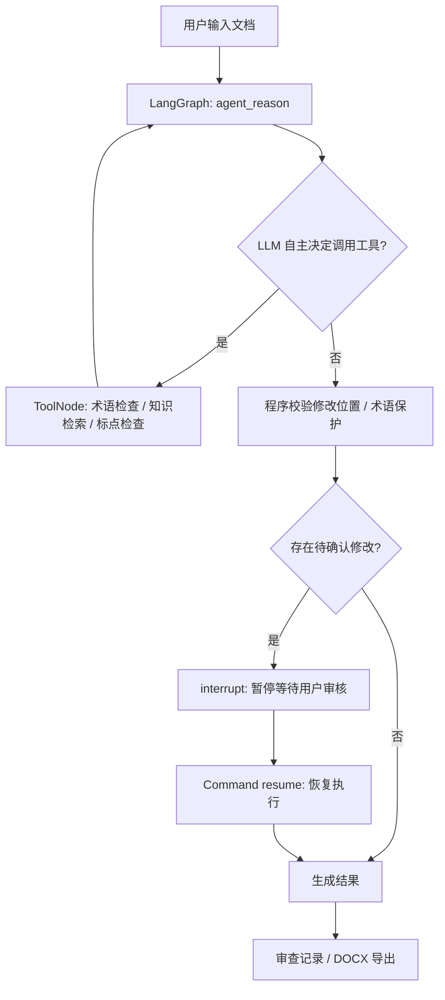

# CryptoProof Agent · 密码领域文档智能校对与审查 Agent

> **项目简介**：基于 **LangGraph + LangChain + RAG + Human-in-the-Loop + FastAPI + SQLite** 实现的领域文档校对与审查 Agent。支持模型自主工具调用、术语检索、可追溯修改建议、人工审核和 DOCX 导出。项目使用独立编写的演示术语及规则数据，不包含第三方机构的内部代码或资料。仅用于非敏感文本测试，不得用于涉密文档处理。

## 一分钟理解“为什么它是智能体”



**区别于普通校对软件**：在 `AGENT_MODE=llm` 下，调用支持 Function/Tool Calling 的大模型，通过 `.bind_tools(TOOLS)` 动态选择调用 `lookup_term_candidates`、`search_knowledge`、`inspect_punctuation`；由 LangGraph `ToolNode` 真正执行，再将结果交回模型进行下一步推理。模型不直接修改文件，修改必须经程序校验和人工批准。`SqliteSaver` 保存 LangGraph 检查点，可在服务重启后使用同一任务 ID 恢复等待审核的任务（单进程演示用途）。

`AGENT_MODE=demo` 是**确定性模拟代理**，用于零密钥运行和测试 ToolNode、检查点、人工审核。它**不是 LLM 自主选择工具**；演示模式的执行结果不能视为真实 LLM Agent 的性能测试结果。

## 快速开始（Python 3.11+）

```bash
# 1. 解压，在项目根目录执行
python -m venv .venv
# Windows PowerShell: .venv\Scripts\Activate.ps1
# macOS/Linux: source .venv/bin/activate
python -m pip install -e '.[dev]'

# 2. 默认无需 API Key，启动 LangGraph 演示代理
uvicorn cryptoproof.api:app --host 127.0.0.1 --port 8000 --reload

# 3. 浏览器访问
# http://127.0.0.1:8000
# API 自动文档：http://127.0.0.1:8000/docs
```

离线演示的预期：输入 `本系统采用数子签名，并使用数字正书。`，提交后展示两个候选，能在轨迹看到 tool_requested / tool_returned，勾选后点击采纳，得到 `本系统采用数字签名，并使用数字证书。`。如无候选，直接完成。原文不会未经人工确认被改动。

### 切换成真正的 LLM Agent

复制 `.env.example` 为 `.env`，设置以下环境变量（`.env` 不会被 Git 收录）：

```bash
AGENT_MODE=llm
OPENAI_API_KEY=你的模型供应商密钥
OPENAI_MODEL=gpt-4o-mini
RAG_MODE=sparse
```

**注意：原生 Python/uvicorn 不会自动读取 `.env`。** 需在终端导入环境变量，或者使用已安装的 uvicorn 参数 `--env-file .env`：

```bash
uvicorn cryptoproof.api:app --env-file .env --host 127.0.0.1 --port 8000
```

可选配置 `OPENAI_BASE_URL` 使用兼容 OpenAI Chat Completions 且支持工具调用的服务；不是所有“兼容接口”都支持工具调用。启用 `llm` 后会真实消耗 Token 并产生供应商费用。

工具调用轨迹存于接口响应的 `trace` 字段，不等同于模型隐藏思维链。不要将私有或敏感内容放入未经授权的第三方模型服务。

### RAG 的两种模式（不要混淆）

- `RAG_MODE=sparse`（默认）：**真实可运行的稀疏向量检索**，使用字符 n-gram TF-IDF 和余弦相似度检索文档/术语。无外部 API，适合展示 RAG 检索增强链路，但**不是神经网络语义 Embedding**。
- `RAG_MODE=semantic`：通过 `langchain_openai.OpenAIEmbeddings` 生成真实密集语义向量，使用项目内 SQLite 存储向量并按余弦相似度检索。需要 API Key、Embedding 模型支持和相应额度。示例知识库很小，SQLite 的朴素向量检索不适合大规模生产；生产可换 Chroma/Qdrant/pgvector。

```bash
# 开启真实 Embedding 语义检索（需有效模型 API）
RAG_MODE=semantic
EMBEDDING_MODEL=text-embedding-3-small
OPENAI_API_KEY=你的密钥
```

> 术语精确查错 `detect_known_typos()` 与 RAG `retrieve()` **互相补充而非同一个模块**。精确匹配适合一字差、已知误拼；RAG 负责获得术语解释及依据供 Agent 决策。

## 使用 API

```bash
curl -s -X POST http://127.0.0.1:8000/api/tasks \
  -H 'Content-Type: application/json' \
  -d '{"text":"数子签名用于检查数字正书。"}'
```

返回 `task_id`、`status=awaiting_review`、`edits` 及 `trace`。审核后：

```bash
curl -s -X POST http://127.0.0.1:8000/api/tasks/<task_id>/approve \
  -H 'Content-Type: application/json' \
  -d '{"approved_ids":["edit-001","edit-002"]}'
```

- `GET /api/tasks/{task_id}` 查看任务；`POST /api/tasks/upload` 上传 `.txt` / `.docx` / 可提取文字 `.pdf`；
- `POST /api/knowledge/search` 请求 `{"query":"数字签名"}` 查看 RAG 检索结果与出处；
- `GET /api/tasks/{task_id}/download.docx` 审核完成后下载 Word 修订稿及修改记录；
- `GET /api/health` 查看运行模式。

## 测试、评测和运行记录

```bash
python -m pytest -q
python -m scripts.evaluate
python -m scripts.offline_preview
```

`tests/test_agent_integration.py` 测试 **实际 LangGraph ToolNode → Interrupt → Command(resume) → DOCX 下载**（需要已安装 LangGraph 依赖）。`knowledge/evaluation.json` 是小型自建示例，`scripts.evaluate` **仅评估词库规则的候选提取**，不能证明真实 LLM 校对准确率，也不能当成第三方 Benchmark。

### Docker 启动

```bash
docker compose up --build
# http://127.0.0.1:8000
```

`docker-compose.yml` 将端口绑定到 `127.0.0.1`，避免没有认证的 Demo 直接对公网开放。SQLite 检查点保存在 `./data/checkpoints.sqlite`。保持单实例、单 worker 运行；多用户生产环境应使用 PostgresSaver、任务队列、鉴权与限流。

## 代码结构

```text
cryptoproof-agent/
├── cryptoproof/
│   ├── agent.py          # LangGraph ReAct 风格工具调用 + 中断恢复
│   ├── tools.py          # LangChain @tool：词库、RAG、标点检测
│   ├── knowledge.py      # 术语库、TF-IDF 检索、可选真实 Embedding
│   ├── editor.py         # Pydantic、位置验证、冲突检测、授权应用
│   ├── documents.py      # TXT/DOCX/PDF 文字抽取
│   └── api.py            # FastAPI、SQLite 检查点、接口和 DOCX 导出
├── static/index.html    # 浏览器上传、审核、轨迹、导出 UI
├── knowledge/
│   ├── glossary.json     # 可公开演示的密码术语数据
│   ├── rules.json        # 知识检索规则文档
│   └── evaluation.json   # 自建基础校验样本
├── tests/               # 核心规则、文档、LangGraph 集成测试
├── scripts/             # 词库基线评估与离线工具预览
├── Dockerfile
├── docker-compose.yml
└── .env.example
```

## 技术架构与核心实现位置

| 技术 | 实现位置 | 核心功能 |
|---|---|---|
| LangGraph StateGraph | `agent.py` | 状态节点、条件边、Agent ↔ Tool 循环 |
| Tool Calling | `agent.py`, `tools.py` | LLM `bind_tools` 发请求，ToolNode 真执行 |
| Human-in-the-Loop | `agent.py` | `interrupt()` 和 `Command(resume=...)` |
| 持久化 | `api.py` | SqliteSaver 保存线程 ID 与检查点 |
| RAG / Retriever | `knowledge.py`, `tools.py` | 检索返回带 source 的知识片段 |
| Embedding | `knowledge.py` | semantic 模式真正调用 OpenAIEmbeddings |
| Prompt | `agent.py` | 系统指令、禁止执行文件内指令、限制输出结构 |
| FastAPI / Pydantic | `api.py`, `editor.py` | 参数校验、任务接口、数据结构约束 |
| 文档解析 | `documents.py` | TXT、DOCX、PDF 文字提取 |
| 安全应用候选 | `editor.py` | 偏移一致、去重、拒绝未批准修改 |
| Docker / Git / pytest | 根目录、`tests/` | 一键复现、自动化用例 |

## 已知限制与下一阶段

1. 原合作项目报告中的专用错别字/语法模型、PyCorrector、OpenCC、原生 PDF OCR、保留 DOCX 原段落格式、文件中断续传，**本次没有复刻**。当前项目是面向真实 Agent 架构的可运行 MVP，不能宣称与原系统功能或精度等价。
2. 扫描 PDF 没有文字时明确报错；最大文件 3MB、文本 20,000 字符，未实现长文件异步分片与队列。`FastAPI` 同步请求可能阻塞，不建议直接用于高并发生产。
3. Demo 词典只有少量人工编制条目，不能作为规范权威来源；知识库中 `source` 只是内部示例来源标签，不是真实法规出处。
4. 所有建议需用户审核；模型额外生成的改动被程序标为 `llm_unverified`，不把模型自己声称的出处当真实证据。即便 `risk=low` 也不会自动应用。
5. 没有用户身份认证、租户隔离、限流、PII 脱敏、完整指标监控或生产级权限审计。**仅在本地或隔离测试环境使用，严禁上传涉密文档。**
6. 外部模型服务和 Python 依赖需联网安装；项目维护者应在具备网络的环境中完成真实 LLM 模式集成测试，不得仅因 demo 可运行就声称真实 LLM 模式已验证。

## 项目来源说明

本仓库的程序实现和示例数据独立编写，围绕专业文本术语校对、修改审查和过程追踪构建。演示词库不代表官方标准；任何非公开资料、第三方机构内部术语库或未经授权的文档均不应上传至公共仓库。