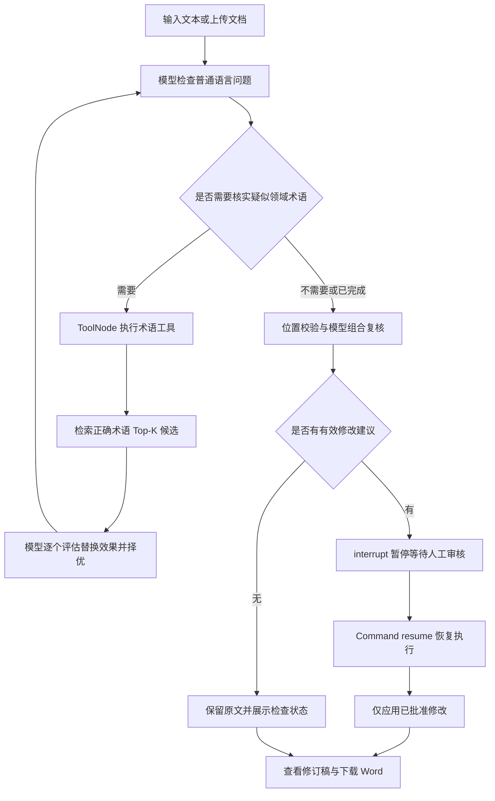
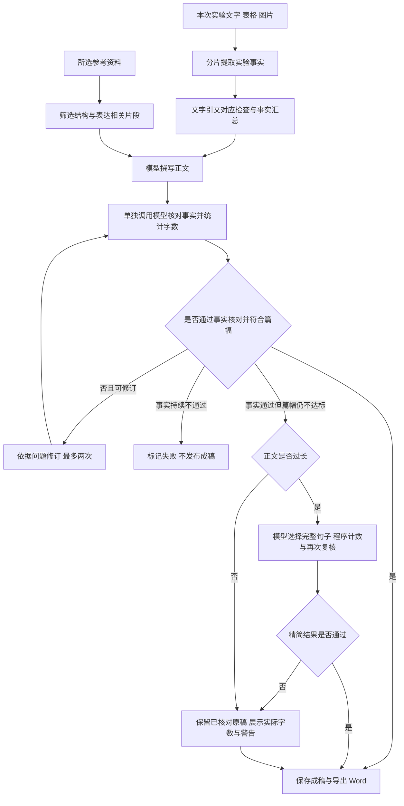

# CryptoProof Agent · 专业文本校对与参考资料写作

> **项目简介**：基于 **LangGraph + LangChain + FastAPI + SQLite** 实现的专业文档处理系统。提供两条业务流程：一是由大模型按需调用领域术语工具、经人工审核后应用修改的文本校对；二是依据实验素材、参考资料库中的行文方式生成分析文档。支持多领域术语库、独立参考资料库、文字与图表输入、篇幅控制和 Word 导出。

## 项目功能

| 模块 | 主要功能 |
|---|---|
| 文本校对 | 检查错别字、语病、标点和语义问题，按需核实疑似专业术语 |
| 多领域术语库 | 添加、删除和下拉切换密码学、通信、网络安全等领域的正确术语列表 |
| 人工审核 | 逐条查看修改原因，选择采纳或全部不采纳，再生成修订稿 |
| 参考资料库 | 添加、预览、删除和多选论文、分析文档、报告，与术语库独立管理 |
| 文档生成 | 根据本次实验文字、表格或图片，参考所选资料的结构和表达生成正文 |
| 篇幅控制 | 设置 300～6000 字目标，通过程序计数、模型修订和完整句子选择控制篇幅 |
| 结果保存 | 校对检查点持久化；生成任务保存输入快照、进度和历史结果 |
| 文档导出 | 复制正文，下载包含审核记录或来源说明的 DOCX 文件 |

## 一分钟理解“为什么它是智能体”

校对主流程使用 LangGraph 组织模型决策、工具执行、结果校验和人工审核：



**模型的自主性**体现在是否调用 `review_domain_term`、核实哪个原文片段，以及如何结合工具结果继续校对。通过 `bind_tools()` 提供工具描述，由模型产生 `tool_calls`，再由 `ToolNode` 执行。普通语言问题不要求查询术语库。

**程序的约束**包括所选术语库、候选数量、工具调用轮数、候选评估流程、修改位置与重叠校验。工具内部的“检索 → 逐候选评估 → 择优”采用固定编排。候选不合适时允许保留原文，最终术语修改不能绕过已完成的候选评估。

文档生成采用“提取事实 → 参考写作 → 核对与修订”的固定工作流。真实模式下两个模块均使用外部模型 API，项目没有训练或微调模型，也不将不同提示词下的多次调用描述为多个独立自治 Agent。

## 快速开始（Python 3.11+）

### 1. 安装依赖

在项目根目录执行。Windows PowerShell：

```powershell
python -m venv .venv
.\.venv\Scripts\Activate.ps1
python -m pip install -e ".[dev]"
```

macOS / Linux 使用 `source .venv/bin/activate` 激活环境，其余安装步骤相同。Windows 如果不方便激活，也可以使用 `.\.venv\Scripts\python.exe` 执行后续 Python 命令。

### 2. 配置真实模型

首次配置时，将 `.env.example` 复制为 `.env`；已有 `.env` 时直接编辑，保留自己的密钥和配置。

以本项目验证过的 DeepSeek 配置为例，模型名称需以账户实际可用的模型为准：

```dotenv
AGENT_MODE=llm
OPENAI_API_KEY=填写你的DeepSeek_API_Key
OPENAI_BASE_URL=https://api.deepseek.com
OPENAI_MODEL=deepseek-flash

TERMS_FILE=knowledge/crypto_terms_zh.txt
TERM_CANDIDATE_LIMIT=5
AGENT_MAX_TURNS=12
```

`OPENAI_*` 是兼容接口使用的配置名称，供应商由 `OPENAI_BASE_URL` 决定。校对模型需要支持工具调用；生成实验图片分析需要支持图片输入的模型。校对端当前带有 DeepSeek 的 `thinking` 扩展参数，切换供应商时还需确认接口兼容性，不能只改模型名称。

### 3. 启动服务

```powershell
python -m uvicorn cryptoproof.api:app --env-file .env --host 127.0.0.1 --port 8000
```

**写入 `.env` 不会自动启用模型。** 原生 Python/uvicorn 不会自动加载该文件，需要使用 `--env-file .env` 或提前设置进程环境变量；已有环境变量优先于文件中的同名配置。修改模型配置后需重启服务。开发时可以添加 `--reload`，但代码重载会中断正在生成的文档。

| 页面 | 地址 |
|---|---|
| 文本校对与术语库管理 | <http://127.0.0.1:8000/> |
| 文档生成与参考资料库管理 | <http://127.0.0.1:8000/generate> |
| API 自动文档 | <http://127.0.0.1:8000/docs> |
| 运行状态 | <http://127.0.0.1:8000/api/health> |

### 离线演示模式

不配置 API Key 时，可以在 `.env` 中设置 `AGENT_MODE=demo`，使用同一启动命令运行。

默认演示术语库下，输入 `本系统采用数子签名，并使用数字正书。`，可体验候选展示、人工采纳和 Word 导出。演示模式使用固定规则模拟模型消息，只用于验证工具循环和审核流程，不代表真实模型的校对能力。自定义领域的真实纠错及文档生成需要 `AGENT_MODE=llm`。

## 多领域术语库与文本校对

### 术语库管理

首次启动会从 `knowledge/crypto_terms_zh.txt` 初始化“密码术语库”。在校对页面的“领域术语库”中，可以下拉切换当前库，或上传 TXT 添加通信、网络安全等其他领域的术语库。

术语文件使用 **UTF-8 编码，每行一个正确术语**，无需枚举误写形式：

```text
数字签名
数字证书
非对称加密
密钥管理
```

导入时自动去除空行和重复项。单库最大 1MB、最多 20000 条，每条最多 120 字符。

`TERMS_FILE` 只用于首次初始化，支持绝对路径；相对路径以项目根目录为基准。导入后通过网页管理，修改原 TXT 不会覆盖数据库中的术语库。删除所有术语库后重启不会重新导入默认库，需要手动添加。

每次校对提交 `library_id`，后端将所选库内容保存为任务快照。切换或删除术语库不会改变已提交任务；没有术语库时，需要先添加才能发起校对。

### 正确术语检索与候选评估

当前真实校对流程通过 `search_term_candidates()` 检索正确术语，采用字符 1/2/3-gram TF-IDF、`SequenceMatcher` 序列相似度和字符集合 Jaccard 相似度组合排序：

```text
精确匹配：score = 1
近似匹配：score = 0.55 × 序列相似度 + 0.35 × TF-IDF 余弦相似度 + 0.10 × Jaccard 相似度
```

候选至少需要与查询共享一个字符，默认返回前 5 个，`TERM_CANDIDATE_LIMIT` 可配置，范围为 1～12。分数只用于候选排序，不是修改正确率；当前权重是工程启发式，尚未通过独立标注集证明最优。完全没有共同字符的同音误写或缩写可能漏召回。

模型决定核实某个疑似片段后，工具为每个返回候选分别构造替换上下文，并调用模型评估：

- 是否引入严重语病；
- 是否保留原意；
- 是否适合当前专业领域；
- 是否确实改善原文。

所有候选均基于同一份原始上下文独立试替换，避免评估之间互相影响。之后再调用模型比较择优，也允许全部拒绝。最后还有一次全文组合复核，因此单次校对可能包含多次模型请求。

**检索增强的范围**：当前多术语库校对与 `/api/knowledge/search` 不调用 Embedding API。`knowledge.py` 保留了旧辅助函数 `retrieve()` 的 `sparse/semantic` 分支，供 demo 和脚本使用；`RAG_MODE=semantic` 不会把当前网页校对切换为语义向量检索。旧 `glossary.json` 和固定误写规则也不参与真实 LLM 校对的自动补改。

### 修改校验与人工采纳

模型返回 `start/end/original/replacement`，索引采用 Python 字符串的左闭右开区间。程序检查原文是否匹配、位置是否越界、修改是否重复或重叠。索引错误时，只对原文中唯一出现的片段自动对齐；重复片段位置不明确时保留原文。

审核通过后，仅应用本任务有效修改 ID 对应的建议，并从右向左替换，避免长度变化影响原始坐标。来源字段由程序标记为待人工核实的模型建议，不把模型自称的出处视为权威证据。

| 字段 | 含义 |
|---|---|
| `status` | 当前校对和审核进度，如 `awaiting_review`、`completed`、`incomplete` |
| `analysis_complete` | 模型检查是否完整，工具失败或无效结果可能使其为 `false` |
| `review_completed` | 用户是否已完成人工审核，包括全部不采纳 |
| `summary` / `warnings` | 模型概述、检查范围和未采用候选说明 |
| `trace` | API 保留的工具请求与返回记录，不是模型隐藏思维链 |

部分工具检查失败时，仍允许采纳其他有效建议，并在页面和导出文件中保留范围说明。未获得有效最终结果且尚未完成人工审核的任务，不能当作成稿导出。前端展示修改建议、修订稿与术语库管理，不展示工具轨迹面板。

## 根据实验素材与参考资料生成文档

在 `/generate` 页面完成以下步骤：

1. 添加论文、分析文档或报告到独立参考资料库，可预览、删除，每次最多选择 6 份。
2. 填写本次实验结果，或上传最多 8 个实验附件，支持文字、表格与图片。
3. 设置可选标题、写作要求和 300～6000 字的目标篇幅。
4. 提交后查看分析、写作、复核进度；完成后复制正文或下载 Word。
5. 从“最近生成”恢复历史结果。刷新网页不会终止同一服务进程中的后台生成。

### 生成流程与事实边界



实验素材是本次事实来源，参考资料只用于借鉴结构、段落组织、术语表达和论证方式。写作提示与审核提示要求区分这两类输入，不能把参考论文的样本量、成功率、耗时或硬件配置写成本次测量。

文字事实需附 `evidence_quote`，程序检查去除空白后的引文是否存在于原素材中，不匹配的事实会被排除，并重新构建事实摘要。附件同时包含文字与图片时，分开分析，避免图片输入使文字引文检查失效。图片内容由视觉模型识别，不能通过文字子串匹配保证其正确性。

事实审核检查正文和缺失信息清单，关注统计单位、成功与失败记录、参数矛盾、重复记录及无依据的结论。例如，轮密钥的四个字节恢复不等于完整主密钥恢复；“没有报告某步骤”也不等于“没有执行该步骤”。审核是单独的模型调用，不保证消除全部幻觉，生成稿仍需作者核验。

参考资料按字符分块，保留开头，并通过查询与片段的字符 n-gram 重合程度筛选相关内容，限制上下文总预算。这里没有使用 Embedding 向量检索。提示词将资料文本、文件名和库元数据标记为待分析数据，要求模型不执行其中的指令；这不等于已经实现完整的提示注入防护。

### 字数控制

字数按**正文非空白字符数，包含标点**统计，标题与来源附录不计入，允许目标值上下浮动 15%。

程序先给出篇幅预算，生成后精确计数，不达标时最多自动修订两次。仍过长时，由模型选择应保留的完整句子，程序按原顺序组合、精确计数，并再次审核事实和衔接。不能安全达到范围时，保留已经核对的正文，明确展示实际字数与警告，不直接截断或虚报达标。

### 模型配置

生成默认复用校对的 `OPENAI_MODEL`、`OPENAI_BASE_URL`、`OPENAI_API_KEY`。需要独立配置时，在 `.env` 中填写：

```dotenv
# 可选：文字生成模型，未填写时继承 OPENAI_* 对应配置
# GENERATION_MODEL=你的文字生成模型
# GENERATION_BASE_URL=模型接口地址
# GENERATION_API_KEY=模型密钥

# 可选：图片分析模型，未填写时先继承 GENERATION_*，再继承 OPENAI_*
# VISION_MODEL=支持图片输入的模型
# VISION_BASE_URL=视觉模型接口地址
# VISION_API_KEY=视觉模型密钥
```

生成调用采用 JSON 输出模式，并使用 Pydantic 校验结构。图片模型需支持所用接口的图片消息格式，不能假定所有兼容服务都支持视觉输入。

## 支持格式与输入限制

| 用途 | 支持格式 | 限制 |
|---|---|---|
| 校对文字 | 直接输入 | 最多 20000 字符 |
| 校对文档 | UTF-8 TXT、DOCX、文字型 PDF | 单文件 3MB，提取后最多 20000 字符；PDF 最多 40 页 |
| 术语库 | UTF-8 TXT，每行一个正确术语 | 单库 1MB、20000 条，每条最多 120 字符 |
| 写作参考资料 | UTF-8 TXT、Markdown、DOCX、文字型 PDF | 单文件 20MB、提取文字最多 180000 字符；PDF 最多 100 页 |
| 实验附件 | 参考资料格式，以及 CSV、XLSX、PNG、JPEG、WebP | 单文件 20MB、提取文字最多 180000 字符；PDF 最多 100 页 |
| 单次生成输入 | 手动实验文字与已上传附件 | 最多 6 份参考资料、8 个附件；手动实验文字最多 60000 字符，实验文字合计最多 120000 字符 |
| 写作设置 | 标题与写作要求 | 标题最多 160 字符，写作要求最多 3000 字符 |
| 单次生成图片 | 实验附件中提取或单独上传的图片 | 合计最多 12 张，单张最多 2000 万像素，Base64 编码后合计最多 32MB |
| 目标篇幅 | 中文分析正文 | 300～6000 字，允许 ±15% |

校对模块只提取 DOCX 普通段落；写作模块按正文中的段落与表格顺序提取，实验内嵌图片单独分析，不保留图片与文字的精确排版关系。参考论文的图片仅计数，不用于写作分析。扫描 PDF 需提供文字版或把关键图片单独上传；PDF 表格列关系、Excel 未缓存的公式、旧式 MathType 对象、复杂公式与嵌套表格可能提取不完整，页面会给出具体提示。

## 使用 API

接口参数与响应结构可在 `/docs` 中查看和调试。以下 `curl` 示例使用 Bash 语法，ID 和文件路径需替换为实际值。

### 文本校对与人工审核

```bash
# 查看术语库；不传 library_id 时使用接口返回的默认库
curl -s http://127.0.0.1:8000/api/libraries

# 提交校对
curl -s -X POST http://127.0.0.1:8000/api/tasks \
  -H 'Content-Type: application/json' \
  -d '{"text":"数子签名用于检查数字正书。","library_id":"<library_id>"}'

# 查看返回的任务 ID、建议、完成状态与警告
curl -s 'http://127.0.0.1:8000/api/tasks/<task_id>'

# 仅采纳指定建议；approved_ids=[] 表示全部不采纳
curl -s -X POST 'http://127.0.0.1:8000/api/tasks/<task_id>/approve' \
  -H 'Content-Type: application/json' \
  -d '{"approved_ids":["edit-001"]}'
```

修改 ID 以任务实际返回的 `edits` 为准。没有可靠修改时可能直接完成；`incomplete` 不能解释为“原文没有错误”。校对提交接口会执行模型检查后返回，不采用文档生成模块的后台任务机制。

### 参考资料与文档生成

```bash
# 添加写作参考资料
curl -s -X POST http://127.0.0.1:8000/api/references \
  -F 'title=实验分析写作范例' \
  -F 'file=@./paper.docx'

# 上传实验附件，记录返回的 id
curl -s -X POST http://127.0.0.1:8000/api/generation/assets \
  -F 'file=@./experiment.csv'

# 创建后台生成任务，返回 HTTP 202
curl -s -X POST http://127.0.0.1:8000/api/generations \
  -H 'Content-Type: application/json' \
  -d '{"title":"实验结果分析","experiment_text":"补充实验条件与结果说明。","instructions":"使用论文实验分析的语气，保留失败结果与限制。","target_words":1200,"reference_ids":["<reference_id>"],"asset_ids":["<asset_id>"]}'

# 查询进度或结果
curl -s 'http://127.0.0.1:8000/api/generations/<generation_id>'

# 完成后下载 Word
curl -o result.docx 'http://127.0.0.1:8000/api/generations/<generation_id>/download.docx'
```

生成状态依次涉及 `queued`、`analyzing`、`writing`、`revising`，终态为 `completed` 或 `failed`。只提供实验文字时可以省略 `asset_ids`，但仍需至少选择一份参考资料；不能同时缺少实验文字和附件。

### 接口一览

| 方法 | 路径 | 功能 |
|---|---|---|
| GET | `/api/health` | 运行模式、校对模型、术语库数量与检索方式 |
| GET / POST | `/api/libraries` | 列出或导入术语库；导入使用 `name`、可选 `domain`、TXT `file` |
| DELETE | `/api/libraries/{library_id}` | 删除术语库 |
| POST | `/api/knowledge/search` | 在指定术语库中检索，JSON 包含 `query`、可选 `library_id` |
| POST | `/api/tasks` | 提交文本校对，JSON 包含 `text`、可选 `library_id` |
| POST | `/api/tasks/upload` | 上传待校对文档，multipart 包含 `file`、可选 `library_id` |
| GET | `/api/tasks/{task_id}` | 查询校对结果与审核状态 |
| POST | `/api/tasks/{task_id}/approve` | 提交 `approved_ids`，恢复人工审核流程 |
| GET | `/api/tasks/{task_id}/download.docx` | 下载已完成的校对结果与审核记录 |
| GET / POST | `/api/references` | 列出或添加参考资料；添加使用 `file`、可选 `title` |
| GET / DELETE | `/api/references/{reference_id}` | 预览或删除参考资料 |
| POST | `/api/generation/assets` | 上传实验附件 |
| POST | `/api/generations` | 创建文档生成任务 |
| GET | `/api/generations` | 列出最近 20 个生成任务 |
| GET | `/api/generations/{generation_id}` | 查询生成进度、正文和来源信息 |
| GET | `/api/generations/{generation_id}/download.docx` | 下载已完成的生成文档 |

## 持久化与任务恢复

默认使用项目根目录的 `data/`，可通过 `DATA_DIR` 配置。

| 文件 | 保存内容 |
|---|---|
| `checkpoints.sqlite` | LangGraph 校对状态、消息、修改建议与人工审核检查点 |
| `libraries.sqlite` | 多领域术语库及术语记录 |
| `research.sqlite` | 写作参考资料、实验附件、生成任务、输入快照与正文 |

校对任务通过 `thread_id` 对应检查点，等待人工审核的任务可以在重启后通过同一任务 ID 继续审核。正在执行的外部模型请求不能依靠检查点原地续传。

文档生成使用**进程内双线程池**执行，SQLite 保存状态；这不是持久化消息队列。服务重启会将未完成的生成任务标记为失败，不自动续跑，用户可以重新发起。刷新网页只影响页面连接，不等于服务重启。

每次生成保存所选参考资料和实验附件的内容快照，删除资料库中的原条目不会破坏历史任务。资料与附件保存的是解析结果及提取的图片数据，不是原文件归档。生成存储采用 WAL，并在状态更新中使用事务；仍应保持单实例、单 worker 运行。

## 测试、评测和运行记录

```bash
# 自动化测试，不需要真实模型密钥
python -m pytest -q

# 旧规则基线评估与离线工具预览
python -m scripts.evaluate
python -m scripts.offline_preview
```

测试覆盖 LangGraph 工具循环、`interrupt`/`Command(resume=...)`、多库隔离、候选评估、位置与重叠检查、人工采纳、资料快照、文字引文检查、事实与参考分离、篇幅修订、文件上传和 Word 导出。模型相关自动化测试主要使用可控替身，便于稳定复现正常和异常分支。

开发验证中还进行了真实 DeepSeek 文字生成、图片事实提取和浏览器操作检查。自动化测试通过与真实 API 可调用，都不等于已经证明校对准确率或生成事实正确率。`knowledge/evaluation.json` 和 `scripts.evaluate` 仅用于小型规则基线，不代表真实 LLM 的整体效果。

进一步评测需要独立标注集，分别统计术语召回 `Recall@K`、纠错 Precision/Recall、正确文本误改率、生成事实支持率、篇幅达标率、耗时和 Token 成本。

## Docker 启动

在 `.env` 中配置模式与模型后执行：

```bash
docker compose up --build
```

Compose 将配置变量注入容器，端口绑定到 `127.0.0.1:8000`，`./data` 挂载到容器的 `/app/data`。文本校对与文档生成访问地址同本地启动方式。使用一个 worker；修改环境配置后需重新创建容器使其生效。

## 代码结构

```text
cryptoproof-agent/
├── cryptoproof/
│   ├── agent.py               # 校对状态图、模型决策、人工中断与恢复
│   ├── tools.py               # 术语工具注册与任务状态注入
│   ├── term_review.py         # 逐候选上下文评估、合格检查与模型择优
│   ├── knowledge.py           # 字符检索与旧版可选语义检索辅助函数
│   ├── libraries.py           # 多领域术语库导入、管理与任务快照
│   ├── editor.py              # 修改结构、位置、重叠与授权应用校验
│   ├── documents.py           # 校对文件的文字提取
│   ├── research_documents.py  # 写作资料、实验文档、表格和图片解析
│   ├── research_store.py      # 独立资料库、实验附件与生成任务持久化
│   ├── generation.py          # 事实提取、参考写作、审核与修订
│   ├── word_budget.py         # 完整句子选择、顺序恢复与精确计数
│   ├── generation_api.py      # 参考资料与生成接口、写作文档导出
│   └── api.py                 # 应用启动、校对接口与页面入口
├── static/
│   ├── index.html             # 文本校对、人工审核与术语库管理
│   ├── app.css / app.js       # 校对页面样式与交互
│   ├── generate.html          # 文档生成与参考资料管理
│   └── generate.css / .js     # 生成页面样式、状态轮询与结果展示
├── knowledge/
│   ├── crypto_terms_zh.txt    # 默认正确术语列表
│   ├── glossary.json          # demo 使用的少量误写示例
│   ├── rules.json             # 旧辅助检索规则示例
│   └── evaluation.json        # 自建规则基线数据
├── tests/                     # 单元测试与接口、状态流转集成测试
├── scripts/                   # 旧规则评估与离线预览
├── data/                      # 本地数据库，不随源码提交
├── artifacts/                 # 本地验证截图与生成示例
├── pyproject.toml
├── Dockerfile
├── docker-compose.yml
└── .env.example
```

`cryptoproof_agent.egg-info/` 是安装过程中生成的包元数据，`PKG-INFO` 等文件不是业务实现；项目说明以当前 `README.md` 为准。

## 技术架构与核心实现位置

| 技术 | 实现位置 | 核心作用 |
|---|---|---|
| LangGraph 状态图 | `agent.py` | 模型与工具循环、条件分支、校对状态管理 |
| Function Calling | `agent.py`、`tools.py` | `bind_tools()` 提供工具描述，`ToolNode` 执行工具 |
| 任务状态注入 | `tools.py` | `InjectedState` 提供后端原文与所选术语库，模型不指定库内容 |
| 检索增强 | `knowledge.py`、`term_review.py` | 字符候选召回，模型结合上下文评估并择优 |
| Human-in-the-Loop | `agent.py` | `interrupt()` 暂停，`Command(resume=...)` 恢复 |
| 确定性修改校验 | `editor.py` | 原文位置一致、区间不重叠、从右向左应用批准项 |
| FastAPI / Pydantic | `api.py`、`generation_api.py` 及模型定义 | 参数校验、上传、任务查询与结构化结果验证 |
| 实验素材解析 | `research_documents.py` | 段落、表格、图片读取和解析限制提示 |
| 参考写作与事实审核 | `generation.py` | 区分事实与写作参考，分片提取、模型审核、失败处理 |
| 程序控长 | `generation.py`、`word_budget.py` | 精确计数、模型修订和完整句子筛选 |
| SQLite 持久化 | `libraries.py`、`research_store.py`、`SqliteSaver` | 库管理、任务快照、生成结果和审核检查点 |
| 后台执行与进度 | `generation.py`、`static/generate.js` | 双线程池执行、前端轮询与历史恢复 |

## 已知限制与下一阶段

1. **模型判断仍可能出错**：候选评分、事实提取和审核均可能漏判。术语来源表示文件位置，不代表权威标准；纯术语列表也不提供完整专业释义。
2. **检索规模与召回有限**：当前术语查询重新构建 TF-IDF，并线性比较候选。后续可预计算索引、缓存结果，并评估拼音或语义召回是否改善效果；权重与方案需要标注集验证。
3. **模型调用成本较高**：逐候选评估、择优和全文复核会增加请求数。后续可在保留独立评估的前提下增加有上限的并发，并记录各阶段耗时和 Token 消耗。
4. **排版与图文解析不完整**：没有通用 OCR、复杂公式完整还原或原始 DOCX 排版保留能力，导出的是重新组织的结果文档。
5. **当前面向本地单实例使用**：没有用户认证、租户隔离、完整限流和生产权限审计；线程池也不支持跨进程持久任务调度。多用户部署需补充鉴权、任务队列、幂等与并发控制，并评估数据库升级。
6. **外部服务与资料处理范围**：真实模型需要联网并产生 API 费用。密钥保存在本地 `.env`，不要提交到仓库；使用外部模型前应确认资料具备相应处理授权，仅用公开或已授权的非涉密资料验证。

## 项目来源说明

项目围绕领域校对、人工审核和参考资料写作构建，演示数据用于说明功能，不代表官方规范或第三方评测结果。用户自行导入的术语、论文、实验素材与数据库不属于默认源码示例；对外分享项目时应检查本地 `data/`、`artifacts/` 以及其他文件中的资料和敏感信息。
