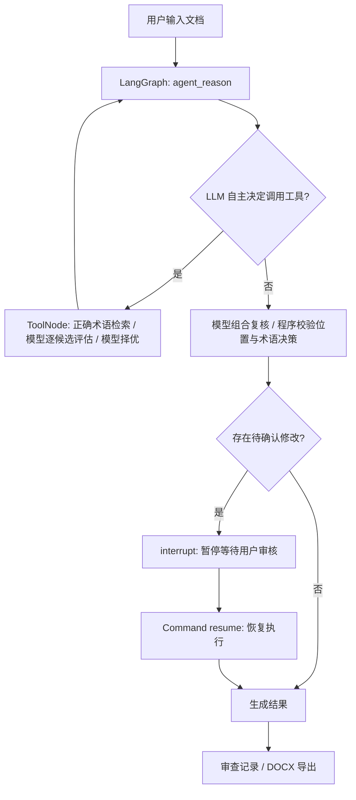

# CryptoProof Agent · 专业文本校对与参考资料写作

> **项目简介**：基于 **LangGraph + LangChain + RAG + Human-in-the-Loop + FastAPI + SQLite** 实现的领域文档校对与审查 Agent。支持模型自主工具调用、术语检索、可追溯修改建议、人工审核和 DOCX 导出。项目使用独立编写的演示术语及规则数据，不包含第三方机构的内部代码或资料。仅用于非敏感文本测试，不得用于涉密文档处理。

## 一分钟理解“为什么它是智能体”



**模型自主调用术语工具**：在 `AGENT_MODE=llm` 下，普通错别字、语病、标点与语义问题由模型处理；模型自主识别疑似密码术语，按需调用 `review_domain_term`。LangGraph `ToolNode` 执行正确术语检索，为本次检索返回的每个候选独立构造替换上下文，逐个请求模型评估语法、原意和专业适配性，再请求模型比较择优或保留原文。最后模型复核组合修改，程序只校验位置与候选决策，不自动添加旧错词表中的修改。所有修改仍需人工批准。`SqliteSaver` 保存检查点，可恢复等待审核的任务（单进程演示用途）。

`AGENT_MODE=demo` 是**确定性模拟代理**，用于零密钥运行和测试 ToolNode、检查点、人工审核。它**不是 LLM 自主选择工具**；演示模式的执行结果不能视为真实 LLM Agent 的性能测试结果。

## 快速开始（Python 3.11+）

```bash
# 1. 解压，在项目根目录执行
python -m venv .venv
# Windows PowerShell: .venv\Scripts\Activate.ps1
# macOS/Linux: source .venv/bin/activate
python -m pip install -e '.[dev]'

# 2. 默认无需 API Key，启动 LangGraph 演示代理
uvicorn cryptoproof.api:app --host 127.0.0.1 --port 8000 --reload

# 3. 浏览器访问
# http://127.0.0.1:8000
# API 自动文档：http://127.0.0.1:8000/docs
```

离线演示的预期：输入 `本系统采用数子签名，并使用数字正书。`，提交后展示两个候选，能在轨迹看到 tool_requested / tool_returned，勾选后点击采纳，得到 `本系统采用数字签名，并使用数字证书。`。如无候选，直接完成。原文不会未经人工确认被改动。

### 切换成真正的 LLM Agent

复制 `.env.example` 为 `.env`，设置以下环境变量（`.env` 不会被 Git 收录）：

```bash
AGENT_MODE=llm
OPENAI_API_KEY=你的模型供应商密钥
OPENAI_MODEL=gpt-4o-mini
RAG_MODE=sparse
```

**注意：原生 Python/uvicorn 不会自动读取 `.env`。** 需在终端导入环境变量，或者使用已安装的 uvicorn 参数 `--env-file .env`：

```bash
uvicorn cryptoproof.api:app --env-file .env --host 127.0.0.1 --port 8000
```

可选配置 `OPENAI_BASE_URL` 使用兼容 OpenAI Chat Completions 且支持工具调用的服务；不是所有“兼容接口”都支持工具调用。启用 `llm` 后会真实消耗 Token 并产生供应商费用。

工具调用轨迹存于接口响应的 `trace` 字段，不等同于模型隐藏思维链。不要将私有或敏感内容放入未经授权的第三方模型服务。

### 多领域术语库管理

首次启动会将 `knowledge/crypto_terms_zh.txt` 导入为“密码术语库”。在页面右下方“领域术语库”中，下拉切换当前库；点击“添加术语库”输入名称、领域并上传 TXT；删除当前库前会显示确认窗口。支持密码、通信、网络安全及其他自定义领域。TXT 使用 UTF-8 编码，每行一个正确术语，空行与重复项自动去除，无需维护误写清单。单库最大 1MB、20000 条，每条最多 120 字。可在 `.env` 设置：

```dotenv
TERMS_FILE=knowledge/crypto_terms_zh.txt
TERM_CANDIDATE_LIMIT=5
AGENT_MAX_TURNS=12
```

`TERMS_FILE` 只用于首次初始化默认库，也支持绝对路径；相对路径以项目根目录为基准。初始化后，术语库持久化在 `DATA_DIR/libraries.sqlite`，通过网页管理；修改原 TXT 不会覆盖已导入的库，更新内容可删除后重新导入。删除所有库后重启不会重新导入默认库。浏览器记住所选库，每次文本/文档校对提交 `library_id`，任务保存完整快照，因此切换或删除库不会影响已提交任务。`/api/health` 返回库数量与模型名称。

术语候选检索使用字符 n-gram TF-IDF 与字符序列相似度，不依赖 Embedding API；多库校对与 `/api/knowledge/search` 均使用这一检索方式，不受旧版 `RAG_MODE` 控制。当前方法可能漏掉没有共同字符的同音误写，模型可用不同片段重试；没有候选不能证明原文正确。纯术语列表不提供释义，专业适配仍由模型判断。

`TERM_CANDIDATE_LIMIT` 限制每次检索返回多少候选。每个候选一次模型评估，之后还有一次模型择优；每个任务最后还有一次全文组合复核，因此比原流程需要更多请求和时间。评估所有本次返回的候选后才选择，不会命中第一个就停止。

页面显示模型 `summary` 和 `warnings`，原工具轨迹区域已替换为术语库管理。API 仍保留 `trace`，其中 `result.evaluations` 可用于开发排查候选比较过程。候选都不合适时保留原文。格式错误、工具失败或轮数上限会明确标记检查未完成，不再把失败静默显示成“没有错误”。模型给错字符索引时，仅对原文中唯一出现的片段自动对齐；重复片段定位不明时不猜测。普通错误不需要调用知识库。旧 `glossary.json` 与固定误写规则只用于 `demo` 模式和基线脚本。

### 旧版检索辅助函数（兼容 demo / 脚本）

以下 `retrieve()` 模式仅供旧辅助工具与脚本使用。当前网页的多库检索不使用语义 Embedding API。

- `RAG_MODE=sparse`（默认）：**真实可运行的稀疏向量检索**，使用字符 n-gram TF-IDF 和余弦相似度检索文档/术语。无外部 API，适合展示 RAG 检索增强链路，但**不是神经网络语义 Embedding**。
- `RAG_MODE=semantic`：通过 `langchain_openai.OpenAIEmbeddings` 生成真实密集语义向量，使用项目内 SQLite 存储向量并按余弦相似度检索。需要 API Key、Embedding 模型支持和相应额度。示例知识库很小，SQLite 的朴素向量检索不适合大规模生产；生产可换 Chroma/Qdrant/pgvector。

```bash
# 开启真实 Embedding 语义检索（需有效模型 API）
RAG_MODE=semantic
EMBEDDING_MODEL=text-embedding-3-small
OPENAI_API_KEY=你的密钥
```

> 术语精确查错 `detect_known_typos()` 与 RAG `retrieve()` **互相补充而非同一个模块**。精确匹配适合一字差、已知误拼；RAG 负责获得术语解释及依据供 Agent 决策。

## 使用 API

```bash
curl -s -X POST http://127.0.0.1:8000/api/tasks \
  -H 'Content-Type: application/json' \
  -d '{"text":"数子签名用于检查数字正书。"}'
```

返回 `task_id`、`status=awaiting_review`、`edits` 及 `trace`。审核后：

```bash
curl -s -X POST http://127.0.0.1:8000/api/tasks/<task_id>/approve \
  -H 'Content-Type: application/json' \
  -d '{"approved_ids":["edit-001","edit-002"]}'
```

- `GET /api/tasks/{task_id}` 查看任务；`POST /api/tasks/upload` 上传 `.txt` / `.docx` / 可提取文字 `.pdf`；
- `POST /api/knowledge/search` 请求 `{"query":"数字签名"}` 查看 RAG 检索结果与出处；
- `GET /api/tasks/{task_id}/download.docx` 审核完成后下载 Word 修订稿及修改记录；
- `GET /api/health` 查看运行模式。

## 测试、评测和运行记录

```bash
python -m pytest -q
python -m scripts.evaluate
python -m scripts.offline_preview
```

`tests/test_agent_integration.py` 测试 **实际 LangGraph ToolNode → Interrupt → Command(resume) → DOCX 下载**（需要已安装 LangGraph 依赖）。`knowledge/evaluation.json` 是小型自建示例，`scripts.evaluate` **仅评估词库规则的候选提取**，不能证明真实 LLM 校对准确率，也不能当成第三方 Benchmark。

### Docker 启动

```bash
docker compose up --build
# http://127.0.0.1:8000
```

`docker-compose.yml` 将端口绑定到 `127.0.0.1`，避免没有认证的 Demo 直接对公网开放。SQLite 检查点保存在 `./data/checkpoints.sqlite`。保持单实例、单 worker 运行；多用户生产环境应使用 PostgresSaver、任务队列、鉴权与限流。

## 代码结构

```text
cryptoproof-agent/
├── cryptoproof/
│   ├── agent.py          # LangGraph ReAct 风格工具调用 + 中断恢复
│   ├── tools.py          # LangChain @tool：词库、RAG、标点检测
│   ├── knowledge.py      # 术语库、TF-IDF 检索、可选真实 Embedding
│   ├── editor.py         # Pydantic、位置验证、冲突检测、授权应用
│   ├── documents.py      # TXT/DOCX/PDF 文字抽取
│   ├── research_documents.py # 写作资料、实验表格与图片解析
│   ├── research_store.py # 独立资料库、素材与生成任务快照
│   ├── generation.py     # 事实提取、参考写作、核对与篇幅修订
│   ├── word_budget.py    # 模型选取完整句子、精确计数
│   ├── generation_api.py # 资料管理、后台生成与 Word 导出接口
│   └── api.py            # FastAPI、SQLite 检查点与校对接口
├── static/index.html    # 校对、人工审核、术语库管理
├── static/generate.*    # 参考资料管理、实验素材与生成结果页面
├── knowledge/
│   ├── glossary.json     # 可公开演示的密码术语数据
│   ├── rules.json        # 知识检索规则文档
│   └── evaluation.json   # 自建基础校验样本
├── tests/               # 核心规则、文档、LangGraph 集成测试
├── scripts/             # 词库基线评估与离线工具预览
├── Dockerfile
├── docker-compose.yml
└── .env.example
```

## 技术架构与核心实现位置

| 技术 | 实现位置 | 核心功能 |
|---|---|---|
| LangGraph StateGraph | `agent.py` | 状态节点、条件边、Agent ↔ Tool 循环 |
| Tool Calling | `agent.py`, `tools.py` | LLM `bind_tools` 发请求，ToolNode 真执行 |
| Human-in-the-Loop | `agent.py` | `interrupt()` 和 `Command(resume=...)` |
| 持久化 | `api.py` | SqliteSaver 保存线程 ID 与检查点 |
| RAG / Retriever | `knowledge.py`, `tools.py` | 检索返回带 source 的知识片段 |
| Embedding | `knowledge.py` | semantic 模式真正调用 OpenAIEmbeddings |
| Prompt | `agent.py` | 系统指令、禁止执行文件内指令、限制输出结构 |
| FastAPI / Pydantic | `api.py`, `editor.py` | 参数校验、任务接口、数据结构约束 |
| 文档解析 | `documents.py` | TXT、DOCX、PDF 文字提取 |
| 安全应用候选 | `editor.py` | 偏移一致、去重、拒绝未批准修改 |
| Docker / Git / pytest | 根目录、`tests/` | 一键复现、自动化用例 |

## 已知限制与下一阶段

1. 原合作项目报告中的专用错别字/语法模型、PyCorrector、OpenCC、原生 PDF OCR、保留 DOCX 原段落格式、文件中断续传，**本次没有复刻**。当前项目是面向真实 Agent 架构的可运行 MVP，不能宣称与原系统功能或精度等价。
2. 校对模块的文件限制为 3MB、文本 20,000 字符；文档生成模块另支持 20MB 素材、后台任务与分片事实提取。扫描 PDF 仍需文字版，实验图片可单独上传。当前采用单进程本地持久化，不建议直接用于高并发生产。
3. Demo 词典只有少量人工编制条目，不能作为规范权威来源；知识库中 `source` 只是内部示例来源标签，不是真实法规出处。
4. 所有建议需用户审核；模型额外生成的改动被程序标为 `llm_unverified`，不把模型自己声称的出处当真实证据。即便 `risk=low` 也不会自动应用。
5. 没有用户身份认证、租户隔离、限流、PII 脱敏、完整指标监控或生产级权限审计。**仅在本地或隔离测试环境使用，严禁上传涉密文档。**
6. 外部模型服务和 Python 依赖需联网安装；项目维护者应在具备网络的环境中完成真实 LLM 模式集成测试，不得仅因 demo 可运行就声称真实 LLM 模式已验证。

## 项目来源说明

本仓库的程序实现和示例数据独立编写，围绕专业文本术语校对、修改审查和过程追踪构建。演示词库不代表官方标准；任何非公开资料、第三方机构内部术语库或未经授权的文档均不应上传至公共仓库。

### 术语库 API

- `GET /api/libraries`：获取库列表、条数、领域与术语预览。
- `POST /api/libraries`：multipart 表单包含 `name`、可选 `domain`、TXT `file`。
- `DELETE /api/libraries/{id}`：删除术语库，不影响原始 TXT 或已有任务快照。
- `POST /api/tasks`：JSON 中可传 `library_id`，缺省使用列表中的第一个库。
- `POST /api/tasks/upload`：multipart 表单支持 `library_id`。
- `POST /api/knowledge/search`：JSON 中传 `query`、`library_id`，只检索指定库。

页面与添加/删除弹窗适配桌面及手机，新增的库重启后仍保留。没有术语库时，需先添加才能提交新任务。

### 人工采纳与校对警告

任务的 `status` 表示处理/审核进度，`analysis_complete` 表示模型检查是否完整，`review_completed` 表示是否已完成人工确认。丢弃不合格术语候选会保留具体警告，不会阻止其他有效建议的采纳。即使部分工具检查失败，用户仍可采纳已通过校验的建议；应用成功后状态为 `completed`，可复制、下载已确认部分的修订稿。页面和 Word 文档均保留检查范围及未采用候选的说明。没有模型最终结果且未人工审核的任务仍禁止导出。

## 根据实验素材与参考资料生成文档

启动服务后访问 `http://127.0.0.1:8000/generate`，或从顶部“文档生成”进入。它使用独立的参考资料库，不混用术语库。

1. 在“选择参考资料”中添加论文、分析文档或报告，可预览、删除，一次最多选 6 份。
2. 填写本次实验文字，或上传最多 8 个结果附件，支持文字、表格和图片；每个文件最大 20MB。
3. 设置标题、写作要求与 300～6000 字的目标篇幅，点击“生成文档”。
4. 在页面查看分析、写作、复核进度。完成后可复制正文、下载 Word；“最近生成”可恢复历史结果。刷新页面不会丢失后台任务。

参考资料支持 UTF-8 TXT/Markdown、DOCX、文字型 PDF。实验附件额外支持 CSV、XLSX、PNG/JPEG/WebP；DOCX 保留段落与表格顺序，实验图片交给视觉模型分析。PDF 表格列关系、Excel 未缓存的公式、MathType 旧式公式或复杂排版不能保证完整提取，页面会显示具体读取提示；参考论文中的图片不用于写作事实推断。单文件提取文字最多 18 万字符，单任务实验文字合计最多 12 万字符、图片最多 12 张。

工作流是：**实验事实提取 → 参考结构与表达写作 → 独立事实核对 → 字数修订**。文字事实要求有可对应原文的引文；图片事实由视觉模型读取。参考资料只用于借鉴写法，不把论文中的样本量、成功率或硬件性能写成本次测量。单目标密钥与字节命中率不能冒充主密钥恢复率；材料未报告某步骤也不能断言该步骤未执行。生成内容仍需作者检查。

字数按正文非空白字符（含标点）统计，标题和来源附录不计入，目标允许 ±15%。最多自动修订两次；仍过长时由模型选择应保留的完整句子，程序精确计数，并再次核对事实与衔接。仍不能达标时保留已核对的正文并明确展示实际字数，不截断或虚报达标。持续未通过事实核对的稿件标为失败，不作为成稿导出。

默认复用 `.env` 的 `OPENAI_API_KEY`、`OPENAI_BASE_URL` 和 `OPENAI_MODEL`，需启用 `AGENT_MODE=llm`。可单独配置 `GENERATION_MODEL/BASE_URL/API_KEY` 和 `VISION_MODEL/BASE_URL/API_KEY`；视觉配置默认继承生成配置。`deepseek-flash` 的图片消息格式参见 [DeepSeek 官方视觉文档](https://api-docs.deepseek.com/guides/vision/)。换用其他供应商时需选择支持图片输入的视觉模型。

资料、实验附件和生成任务存于 `DATA_DIR/research.sqlite`。每次生成保存所选资料与素材快照，删除资料不会破坏历史成稿。服务重启时未完成的任务会明确标为中断，避免一直显示处理中；可以重新发起生成。当前为单 worker、本地 SQLite 与双线程后台队列。

主要代码：`research_documents.py` 解析文件；`research_store.py` 管理资料与快照；`generation.py` 处理模型生成、事实核对与控长；`generation_api.py` 提供接口与 Word 导出；`static/generate.*` 实现页面。

接口：

- `GET/POST /api/references`、`GET/DELETE /api/references/{id}`：参考资料管理。
- `POST /api/generation/assets`：上传实验素材。
- `POST /api/generations`：提交后台任务，返回 202。
- `GET /api/generations`、`GET /api/generations/{id}`：历史与进度。
- `GET /api/generations/{id}/download.docx`：下载已完成的文档。
